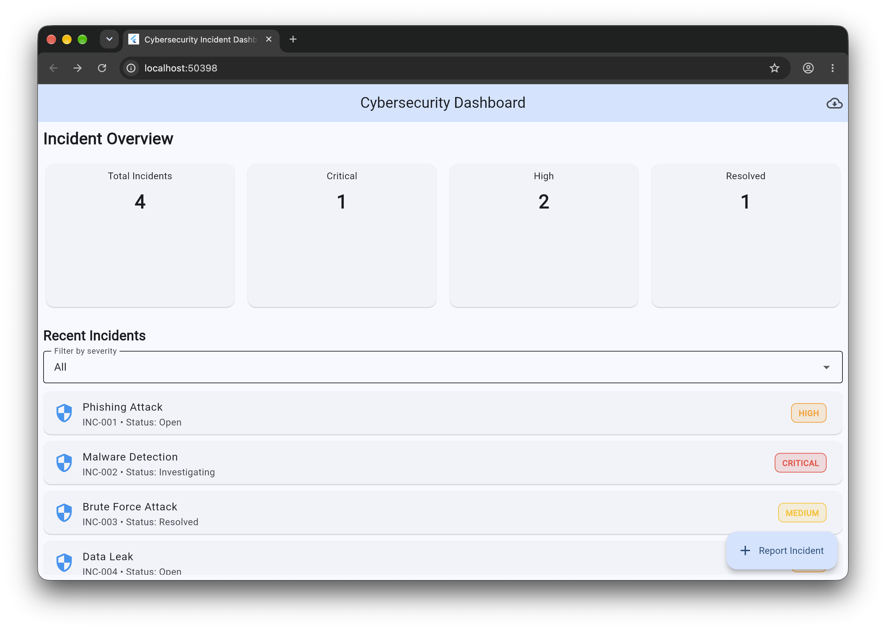
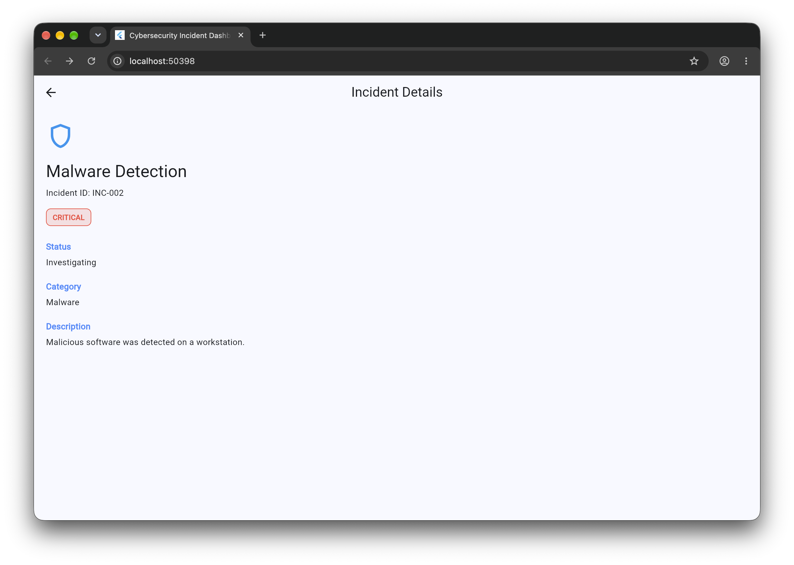
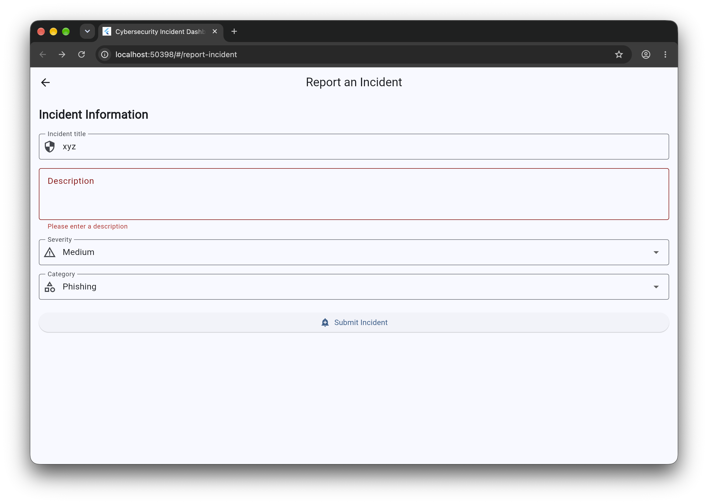
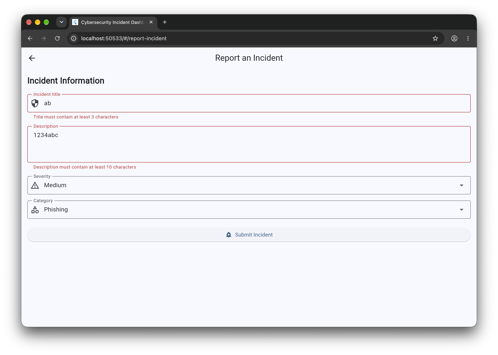
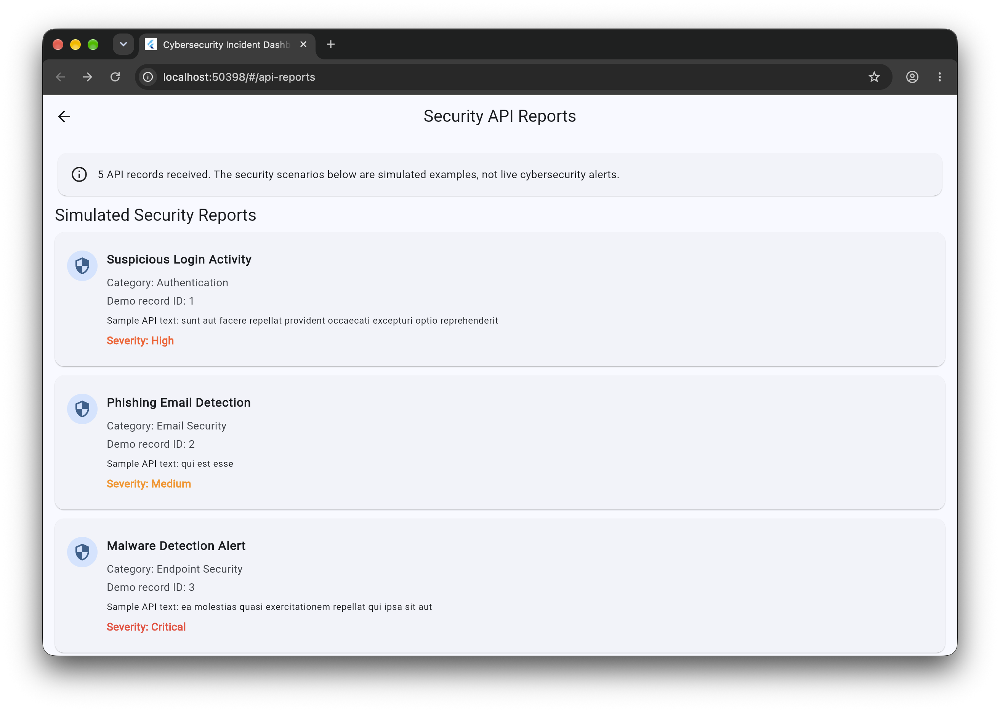

# Cybersecurity Incident Dashboard

A Flutter-based cybersecurity incident dashboard developed for the CS506PC – UI Design (Flutter Lab).

## Features
- Dashboard statistics for total, critical, high-severity, and resolved incidents.
- Filter incidents by severity.
- View incident details.
- Submit incident reports with form validation.
- Reusable severity badges and Material theme.
- Responsive statistics grid using LayoutBuilder.
- Animated dashboard statistics.
- REST API demonstration with loading, error, and retry states.
- Provider-based state management.
- Automated unit and widget tests.

## Technologies
- Flutter and Dart
- Provider
- HTTP package
- JSONPlaceholder demo REST API
- Flutter test framework

## Project Structure
```text
lib/
├── main.dart
├── models/incident.dart
├── providers/incident_provider.dart
├── screens/
│   ├── api_reports_screen.dart
│   ├── incident_details_screen.dart
│   └── report_incident_screen.dart
├── services/api_service.dart
└── widgets/severity_badge.dart

test/
├── incident_provider_test.dart
└── widget_test.dart

screenshots/
├── experiment-01/
├── experiment-02/
├── experiment-03/
├── experiment-04/
├── experiment-05/
├── experiment-06/
├── experiment-07/
├── experiment-08/
├── experiment-09/
└── experiment-10/
```

## Lab Experiments and Evidence

### Experiment 1 – Dart and Flutter Basics
Relevant files: `lib/main.dart`, `lib/models/incident.dart`.
Capture relevant source code and application output in `screenshots/experiment-01/`.

### Experiment 2 – Widgets and Layouts
Relevant files: `lib/main.dart`, `lib/widgets/severity_badge.dart`.
Capture dashboard widgets and layouts in `screenshots/experiment-02/`.

### Experiment 3 – Responsive UI
Relevant file: `lib/main.dart`.
The statistics grid uses `LayoutBuilder` to adjust its column count according to available width. Capture narrow and wide layouts in `screenshots/experiment-03/`.

### Experiment 4 – Navigation
Relevant files: `lib/main.dart`, `lib/screens/incident_details_screen.dart`, `lib/screens/report_incident_screen.dart`, `lib/screens/api_reports_screen.dart`.
Capture navigation between screens in `screenshots/experiment-04/`.

### Experiment 5 – State Management
Relevant file: `lib/providers/incident_provider.dart`.
Capture Provider source code and the updated dashboard in `screenshots/experiment-05/`.

### Experiment 6 – Reusable Widgets and Themes
Relevant files: `lib/widgets/severity_badge.dart`, `lib/main.dart`.
Capture reusable severity badges and the themed interface in `screenshots/experiment-06/`.

### Experiment 7 – Forms and Validation
Relevant file: `lib/screens/report_incident_screen.dart`.
Capture validation errors and a successful incident submission in `screenshots/experiment-07/`.

### Experiment 8 – Animations
Relevant file: `lib/main.dart`.
The dashboard uses `AnimatedSwitcher` and `ScaleTransition`. Capture the source and, if possible, a short animation recording in `screenshots/experiment-08/`.

### Experiment 9 – REST API Integration
Relevant files: `lib/services/api_service.dart`, `lib/screens/api_reports_screen.dart`.
API endpoint: `https://jsonplaceholder.typicode.com/posts?_limit=5`.
The API supplies demonstration records. The cybersecurity scenarios shown in the interface are simulated examples, not real security alerts.
Capture the API screen and service code in `screenshots/experiment-09/`.

### Experiment 10 – Testing and Debugging
Relevant files: `test/incident_provider_test.dart`, `test/widget_test.dart`.
Run `flutter analyze` and `flutter test`. Capture the results and any genuine debugging evidence in `screenshots/experiment-10/`.

## Getting Started

### Prerequisites
- Flutter SDK
- An IDE such as VS Code or Android Studio
- Internet access for the API demonstration

### Installation
```bash
git clone https://github.com/ManaswiniJillella-MJ/cybersecurity_incident_dashboard.git
cd cybersecurity_incident_dashboard
flutter pub get
flutter run
```

### Verification
```bash
flutter analyze
flutter test
```

## Screenshots
Add genuine screenshots to the experiment folders above. For example:

``

Replace the example filename with the actual screenshot filename.

## Limitations
- Dashboard incidents use sample local data.
- The REST API uses JSONPlaceholder demonstration data.
- The security scenarios are simulated and are not connected to a live security monitoring system.

## Conclusion
This project demonstrates Flutter UI design, navigation, state management, form validation, animation, REST API handling, and automated testing in a cybersecurity-themed application.

## Screenshots and Evidence

### Experiment 2: Widgets and Layouts


### Experiment 4: Navigation


### Experiment 7: Forms and Validation

**Report form:**



**Validation errors:**



### Experiment 9: REST API Integration

